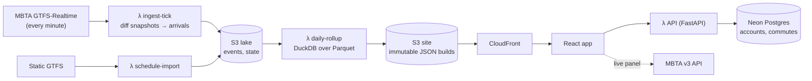

# Stopwatch

**Stop-level transit reliability for riders.** Stopwatch captures the MBTA's real-time feed every minute, works out when each bus and train actually reached each stop, and shows how reliable *your* stop is at *your* time, by hour and by day. It is designed to run 24/7 on a scale-to-zero AWS pipeline for under $1/month.

> Independent, unofficial estimates. Not affiliated with the MBTA.

**Status (2026-10-18):** built and tested locally end to end against the live MBTA feed. Cloud infrastructure is written as Terraform but **not yet deployed** (see [Deploy](#deploy-to-aws)).

## What it does

- **Search any stop**, or find stops near you. Location is computed in the browser and never sent anywhere.
- **Reliability heatmap** by day type × hour: typical (median) and worst-case (p90) delay, % on time (−1 to +5 min), cancellations, and excess wait time on frequent routes. Every cell shows its sample size, and thin cells say "not enough data".
- **Live panel:** the next arrivals, fetched by the browser straight from the MBTA's public API.
- **Saved commutes** (Google sign-in or a 24-hour demo account) with a personal summary for your days and time window.
- *Optional:* **push alerts** when your bus is predicted late or canceled.
- *Optional:* **Ask Stopwatch**, plain-English questions answered only from computed data, with a hard monthly spend cap.
- **Public data-health page:** feed freshness, collection gaps, and daily coverage.

## Measured so far

All numbers are from **one evening of live data (2026-10-18)** on a laptop. Treat them as early, not steady state.

| What | Value |
|---|---|
| Live ingest ticks (one per minute) | ~100 run, **0 failed**; p50 0.54 s, p95 0.62 s per tick |
| Arrivals inferred per minute (Sunday evening) | ~240 |
| Arrivals that join the published schedule (trip + stop sequence) | 96% (the rest are subway trips the MBTA adds on the fly) |
| Agreement with MBTA's official LAMP subway arrival times | median 0 s, p90 2 s, over 2,811 matched arrivals ¹ |
| Static schedule import (3.08M stop times → Parquet + Postgres catalog) | ~10 s |
| Daily rollup for a partial day (26k arrivals → 165 route files) | ~3 s |
| Initial JS (gzip) | 124.6 KB (budget 200 KB) |
| Tests | 300 backend (unit, property-based, golden replay, integration, API authorization matrix), 86 frontend unit, 24 Playwright E2E + axe |
| Estimated AWS cost when deployed | ≈ $0.55/month ([cost model](docs/04-architecture.md#101-cost-estimate-prod-steady-state-after-any-credits)) |

¹ LAMP is computed by the MBTA from the same real-time feeds. Agreement shows that polling once a minute and inferring arrivals from disappearing predictions loses essentially nothing compared with the agency's own processing. It does **not** independently prove the feed is accurate.

A real-data finding worth reading: [feed-notes.md](docs/feed-notes.md). About 18% of the MBTA's stop updates are marked SKIPPED, but 86% of those belong to placeholder trips published up to a day ahead. The pipeline only records a skip once it is confirmed.

## How it works



- **Arrival inference:** the feed only lists *future* stops. When a stop's prediction disappears between two snapshots, the vehicle served it. Vehicle positions refine the estimate. Every arrival carries a method and a confidence level. See [methodology](docs/methodology.md) and [`core/inference/diff.py`](backend/src/stopwatch/core/inference/diff.py).
- **Modular monolith:** one Python codebase with enforced layers (`import-linter`): a pure core with no I/O, then platform adapters, the catalog, ingest, feature modules, and entry points. It is deployed as several Lambda functions in two packages.
- **$0 when idle:** no always-on servers, no NAT, no RDS. The per-minute path never touches Postgres, so the free-tier database can sleep.
- **Trustworthy publishing:** a data-quality gate runs before each atomic manifest swap, and rollback is one command.

Design docs: [architecture](docs/04-architecture.md) · [security & reliability](docs/05-security-reliability.md) · [testing & operations](docs/06-quality-operations.md) · [interface contracts](docs/contracts.md) · [ADRs](docs/adr/README.md) · [runbooks](docs/runbooks/README.md)

## Run it locally

Requirements: Docker, [uv](https://docs.astral.sh/uv/), and Node 22+.

```bash
make install   # backend (uv) + frontend (npm) dependencies
make dev       # Postgres, migrations, API, live worker and web at http://localhost:5173
```

```bash
make demo      # same stack, but the worker replays recorded MBTA snapshots (works offline)
```

If port 8000 is taken on your machine, run `API_PORT=8010 make dev` (the web app still talks to the API inside Docker). The worker imports the MBTA schedule on first start (~10 s), ingests every minute, and publishes a "today so far" build every 15 minutes. Sign in with **Try a demo account**. Google sign-in needs `GOOGLE_CLIENT_ID`/`GOOGLE_CLIENT_SECRET` in `.env` (see `.env.example`).

Useful targets (`make help` lists all of them):

| Target | Does |
|---|---|
| `make test` | All backend tests with coverage (needs `make db`) |
| `make lint` / `make typecheck` | Ruff, module-boundary contracts, mypy (strict on the core) |
| `make ingest-once` / `make rollup DATE=…` | Run one pipeline step on the host |
| `make replay DIR=backend/tests/fixtures/rt_snapshots/sample` | Replay recorded snapshots through inference |
| `make verify-db` | Smoke-check a database (restore drills) |

For the frontend, run `npm test`, `npm run test:e2e` and `npm run build` in `frontend/`. `npm run dev:mock` runs the UI with no backend.

## Deploy to AWS

Everything is Terraform under [`infra/`](infra/). A GitHub Actions pipeline builds once, deploys to staging, runs smoke tests, and promotes to prod behind a manual approval. One-time setup:

1. **AWS account:** MFA on root and an admin user. Run `make bootstrap GITHUB_REPO=<owner/repo> OWNER=<you>`, which creates the Terraform state bucket and the GitHub OIDC deploy roles. Ask AWS to raise the Lambda concurrency quota: new accounts allow 10, and each environment reserves 17.
2. **Neon:** create a free project with an owner role and an app role, then run the migrations (`make migrate-cloud ENV=staging`).
3. **Google OAuth client:** redirect URI `https://<your-cloudfront-domain>/api/v1/auth/callback`.
4. **Infrastructure:** `make up ENV=staging`, then set the SSM parameters (`database_url`, `session_secret`, OAuth, and optionally VAPID and Anthropic keys) with `aws ssm put-parameter --overwrite`. Terraform creates them as `unset`, so these secrets never enter its state (the CloudFront origin secret is the one documented exception). CI needs repository variables and environments; [`infra/README.md`](infra/README.md) lists them.
5. **Alerts:** confirm the SNS email subscription. Budgets alert at $1 actual and $5 forecast.

`make down ENV=staging` removes everything again. Prod refuses to destroy data unless `ALLOW_DATA_DESTROY=1` is set. Details: [06 §4](docs/06-quality-operations.md#4-infrastructure-as-code-terraform).

## Known limitations

- **60-second polling:** arrival times are inferred at minute granularity. The LAMP comparison above suggests little precision is lost.
- **Coverage builds over time:** the published window is 28 days, so a fresh deployment starts thin and every view says so.
- **Unofficial estimates:** delays are measured against the published schedule. Trips the MBTA adds on the fly appear as arrivals but not in delay statistics.
- **Single region, no sub-minute freshness:** a deliberate cost tradeoff ([ADR-003](docs/adr/0003-poll-feeds-every-60-seconds.md)).
- **Real users:** none yet.

## Repository

```text
backend/    Python 3.13: core (pure), platform adapters, ingest, rollups, API, jobs, tests
frontend/   React + TypeScript + Vite app, Vitest + Playwright
infra/      Terraform: bootstrap, modules, staging/prod envs
docs/       Planning (01–08), contracts, ADRs, runbooks, methodology, privacy, feed notes
research/   Job-market analysis data and scripts that motivated the project
evals/      Ask Stopwatch eval set and cost-capped runner
scripts/    Lambda packaging, fixture recording, backups, dev helpers
```

How this was built, and what was verified by hand: [docs/ai-usage.md](docs/ai-usage.md). Planning docs, from market research through portfolio kit: [01](docs/01-market-research.md) · [02](docs/02-concept-selection.md) · [03](docs/03-product-spec.md) · [07 roadmap](docs/07-repo-and-roadmap.md) · [08 portfolio kit](docs/08-portfolio-kit.md).

License: [MIT](LICENSE).
