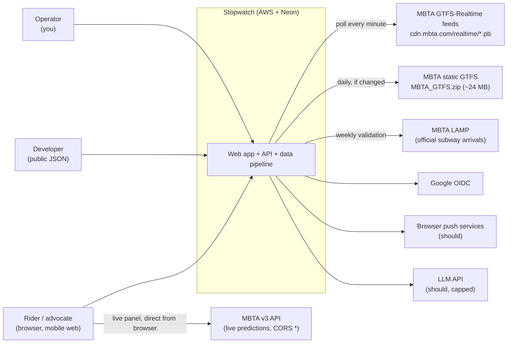
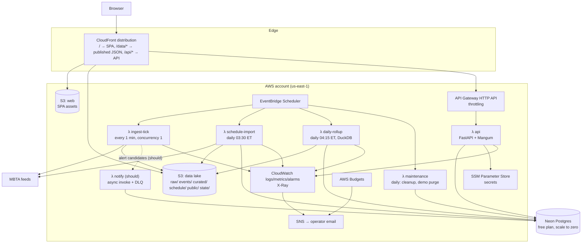
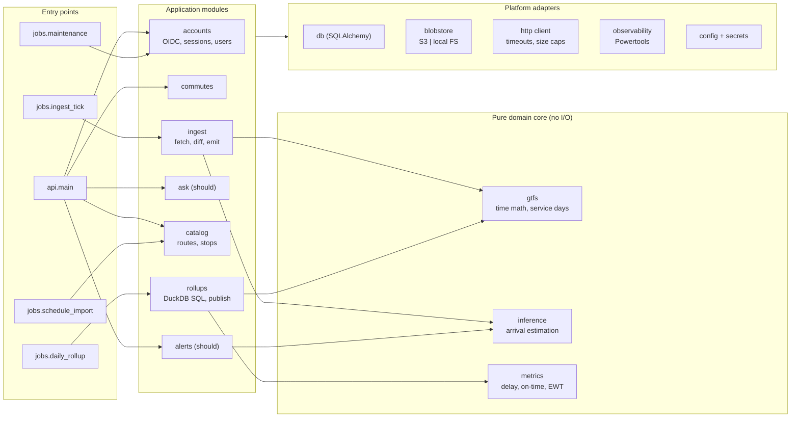
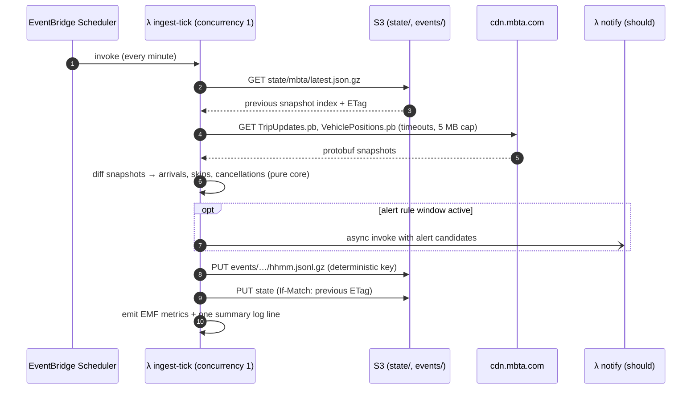

# 04 — Architecture and Technology Stack

*Phase 3 (design) · 2026-10-18 · companion docs: [03 product spec](03-product-spec.md), [05 security & reliability](05-security-reliability.md), [06 quality & operations](06-quality-operations.md)*

## 1. Design principles

1. **$0 when idle.** Nothing runs unless a schedule or a request triggers it, and nothing is billed per hour. Every design choice is checked against the cost estimate (§10.1).
2. **Modular monolith.** One Python codebase and one deployable artifact. Module boundaries are enforced by a linter in CI, and the code has a few *entry points* (API, ingest, rollup, …), not services.
3. **Pure core, adapters at the edges.** Inference and metrics are pure functions with no I/O (easy to test exhaustively). Storage, HTTP and the database sit behind small interfaces with a local and a cloud implementation.
4. **Idempotent by default.** Every job can run twice and every event can be delivered twice without corrupting results.
5. **Boring technology, justified.** Each component below says why it earns its place and what was rejected.

## 2. Technology stack

| Layer | Choice | Why (tied to market data where relevant) | Rejected alternatives |
|---|---|---|---|
| Backend language | **Python 3.13** | Most-requested language (16/18 sampled companies; 10/12 big-tech postings); best GTFS and data tooling; one language for API, jobs and analytics | Go (great fit, but a smaller share of postings; split stack); TypeScript backend (weaker data tooling) |
| API framework | **FastAPI** + Pydantic v2 | Typed request/response models, automatic OpenAPI, async I/O; runs on Lambda via the **Mangum** adapter and locally under uvicorn | Django (heavier than a small JSON API needs); Flask (less built-in validation) |
| Feed parsing | **gtfs-realtime-bindings** (official protobuf bindings) | Reference implementation; parses a full MBTA snapshot in ~12 ms locally | Hand-written protobuf (pointless risk) |
| Analytics engine | **DuckDB** (embedded library) | Runs SQL over Parquet/JSON in S3 from inside a Lambda: columnar aggregations without a server or bill; writes Parquet natively | Postgres for observations (would exceed the 0.5 GB free tier in weeks and keep the database awake); Athena (per-query cost, slower iteration); Spark (absurd at this scale) |
| Transactional DB | **PostgreSQL 17 on Neon (free plan)** | Relational SQL is the named database skill (11/18); scales to zero when idle; branching for migration rehearsal | RDS (≈$12+/month minimum, never idle-free); DynamoDB (relational data, weaker fit; Postgres is the market signal) |
| ORM / migrations | **SQLAlchemy 2.0 (Core)** + **Alembic** | Explicit SQL with typed composition; industry-standard migrations | Raw SQL files (no schema-diff tooling); full ORM models everywhere (hides queries) |
| Object storage | **Amazon S3** | Raw and curated observations, published JSON, state checkpoint; lifecycle expiry; conditional writes for safe state updates | EFS (costly, no lifecycle-friendly analytics) |
| Compute | **AWS Lambda** (zip packages, arm64) | Always-free allowance of 1M requests + 400k GB-s/month; scale to zero; arm64 is cheaper and faster per dollar | ECS/Fargate or EC2 (hourly billing); containers on Lambda (ECR adds a step; zip is enough without pyarrow) |
| Scheduling | **EventBridge Scheduler** | 14M free invocations/month; time-zone-aware cron; retry policy and DLQ | EventBridge rules (fine too, but no time zones); cron on a VM (always-on) |
| HTTP entry | **API Gateway HTTP API** | Route-level throttling, $1 per million requests (≈$0.01/month here) | Lambda Function URLs (free, but no throttling, and OAC body-hash quirks for POST); REST API (3.5× price, features not needed) |
| CDN / static hosting | **CloudFront** + S3 (Origin Access Control) | Always-free allowance; serves the SPA and published data; routes `/api/*` to API Gateway so the app is **same-origin** (no CORS, first-party cookies) | Vercel/Netlify (second vendor; terms for commercial use) |
| Frontend | **React 19 + TypeScript + Vite**, TanStack Query, React Router, **Observable Plot** for charts | React is the named frontend framework (10/18); TypeScript for full-stack credibility; Plot handles heatmaps and distributions in very little code | Next.js (needs a server or edge runtime; SSR isn't needed for a data app); D3 directly (too low-level); Recharts (weaker heatmaps) |
| Auth | **Google OIDC** via Authlib; server-side sessions in Postgres | No password storage; standard auth-code + PKCE flow; revocable sessions | Passwords (liability); Cognito (heavier setup, harder local dev); JWTs in localStorage (XSS-exposed, not revocable) |
| Observability | **Powertools for AWS Lambda (Python)**: Logger, Metrics (EMF), Tracer (X-Ray), Parameters | One library for structured logs, metrics, tracing and cached secret loading; fits CloudWatch's free tier (10 metrics, 10 alarms, 5 GB logs) | Datadog/Grafana Cloud (another vendor; free tiers change); full OpenTelemetry collector (cold-start cost) |
| Secrets | **SSM Parameter Store** (SecureString) | Standard parameters are free; KMS-encrypted | Secrets Manager ($0.40/secret/month) |
| IaC | **Terraform ≥ 1.10**, S3 backend with native lockfile | Most-recognized IaC tool; one command up and down; no DynamoDB lock table needed | AWS CDK (great with Python, but Terraform is more portable and more commonly named); clicking in the console |
| CI/CD | **GitHub Actions** + OIDC federation to AWS | Free for public repos; no long-lived AWS keys | Jenkins (self-hosted); CodePipeline (AWS-only, less common on résumés) |
| Local dev | **Docker Compose** (Postgres + API + scheduler loop + Vite) | One-command local stack at $0; same code paths with local adapters | LocalStack (heavy; not needed thanks to adapters) |
| Packaging | **uv** (Python), **npm** (frontend) | Fast, lockfile-based, reproducible | Poetry/pip-tools (slower, more tooling) |

**Not used, on purpose:** Kubernetes, microservices, Kafka, Redis, GraphQL, NoSQL and Terraform Cloud. In the job-posting data, none of these is an entry-level requirement, and each would add cost or moving parts with no measured need. §11 says when each *would* become justified.

## 3. System context



## 4. Containers and deployment (AWS, us-east-1)



All Lambdas run **outside a VPC**. Neon is reached over TLS on the public internet with credentials from SSM, so there's no NAT gateway (≈$32/month) and no VPC endpoints. This is a deliberate cost-versus-defense-in-depth tradeoff, discussed in [05](05-security-reliability.md).

## 5. Modules (inside the monolith)



**Enforced rules** (checked in CI by `import-linter`):

- `core` imports nothing from `app_mods`, `platform` or any I/O library.
- Application modules talk to each other only through their public `service.py` interfaces.
- Only `platform` touches boto3, SQLAlchemy engines or httpx.

Each entry point is a separate Lambda function **built from the same artifact**: different handler, different IAM role, different memory and timeout.

## 6. Data architecture

### 6.1 Where data lives

| Data | Store | Format | Retention | Approx. size |
|---|---|---|---|---|
| Live state (latest predictions per trip) | S3 `state/mbta/latest.json.gz` | gzip JSON (~170 KB) | overwritten each minute | 170 KB |
| Minute event batches | S3 `events/agency=mbta/dt=…/hhmm.jsonl.gz` | gzip JSON lines | 14 days (lifecycle rule) | ~10 MB/day |
| Hourly raw snapshot samples | S3 `raw/agency=mbta/dt=…/hh.pb` | protobuf | 7 days | ~15 MB/day |
| Curated arrivals | S3 `curated/arrivals/agency=mbta/service_date=…/part-0.parquet` | Parquet (zstd) | indefinitely | ~5 MB/day ≈ 1.8 GB/yr |
| Schedule | S3 `schedule/agency=mbta/version=…/stop_times.parquet` + calendars | Parquet | last 12 versions | ~30 MB/version |
| Published rollups | S3 `public/v1/{build_id}/…` served at `/data/v1/…` | JSON (gzip by CloudFront) | last 14 builds | ~15 MB/build |
| Users, sessions, commutes, audit, catalog, daily route metrics | Neon Postgres | relational | see [05](05-security-reliability.md) privacy table | < 100 MB |

**Why split this way:** observations are append-only, high-volume and scanned in bulk, which is the columnar workload that Parquet and DuckDB are built for. User data is small, relational and transactional, which is what Postgres is for. Keeping the per-minute ingest path off Postgres also lets Neon **sleep**: waking it every minute would burn its 100 compute-hours/month free quota (a 0.25 CU compute running 24/7 is ~180 CU-hours).

### 6.2 PostgreSQL schema (MVP and should)

```sql
create extension if not exists citext;
create extension if not exists pgcrypto;  -- gen_random_uuid()

-- Identity ---------------------------------------------------------------
create table users (
  id             uuid primary key default gen_random_uuid(),
  email          citext unique,                       -- null for demo users
  display_name   text,
  oidc_issuer    text,
  oidc_subject   text,
  is_demo        boolean not null default false,
  demo_expires_at timestamptz,
  created_at     timestamptz not null default now(),
  last_login_at  timestamptz,
  unique (oidc_issuer, oidc_subject),
  check (is_demo or (oidc_issuer is not null and oidc_subject is not null)),
  check (not is_demo or demo_expires_at is not null)
);

create table sessions (
  token_hash   bytea primary key,                     -- sha256 of the 256-bit cookie token
  user_id      uuid not null references users(id) on delete cascade,
  created_at   timestamptz not null default now(),
  last_seen_at timestamptz not null default now(),
  expires_at   timestamptz not null,                  -- absolute limit (30 d; 24 h for demo)
  ip_prefix    inet,                                  -- /24 (v4) or /48 (v6) only
  user_agent   text
);
create index sessions_user_idx on sessions (user_id);
create index sessions_expiry_idx on sessions (expires_at);

-- Transit catalog (loaded from static GTFS) -------------------------------
create table agencies (
  id        text primary key,                         -- 'mbta'
  name      text not null,
  timezone  text not null,                            -- 'America/New_York'
  on_time_early_s smallint not null default -60,
  on_time_late_s  smallint not null default 300
);
create table feed_versions (
  agency_id   text references agencies(id),
  version     text,                                   -- from feed_info.txt
  imported_at timestamptz not null default now(),
  start_date  date not null,
  end_date    date not null,
  primary key (agency_id, version)
);
create table routes (
  agency_id  text references agencies(id),
  route_id   text,
  short_name text, long_name text,
  route_type smallint not null,                       -- 0 tram, 1 subway, 3 bus …
  color      text, sort_order int,
  primary key (agency_id, route_id)
);
create table stops (
  agency_id text references agencies(id),
  stop_id   text,
  name      text not null,
  lat double precision not null, lon double precision not null,
  parent_station text,
  primary key (agency_id, stop_id)
);
create table route_stops (
  agency_id text, route_id text, direction_id smallint check (direction_id in (0,1)),
  stop_id text, stop_order smallint not null,
  primary key (agency_id, route_id, direction_id, stop_id),
  foreign key (agency_id, route_id) references routes,
  foreign key (agency_id, stop_id) references stops
);

-- User features -------------------------------------------------------------
create table saved_commutes (
  id           uuid primary key default gen_random_uuid(),
  user_id      uuid not null references users(id) on delete cascade,
  agency_id    text not null, route_id text not null,
  direction_id smallint not null, stop_id text not null,
  label        text check (char_length(label) <= 60),
  days_mask    smallint not null check (days_mask between 1 and 127),  -- bit 0 = Monday
  window_start time not null,
  window_end   time not null check (window_end > window_start),
  created_at   timestamptz not null default now(),
  updated_at   timestamptz not null default now(),
  foreign key (agency_id, route_id, direction_id, stop_id) references route_stops
);
create index saved_commutes_user_idx on saved_commutes (user_id);

create table idempotency_keys (
  user_id      uuid not null references users(id) on delete cascade,
  key          text not null check (char_length(key) between 8 and 64),
  request_hash bytea not null,
  status_code  smallint not null,
  response     jsonb not null,
  created_at   timestamptz not null default now(),
  primary key (user_id, key)
);

-- Platform -------------------------------------------------------------------
create table rate_limit_counters (
  bucket       text not null,                         -- e.g. 'demo:ip:203.0.113.0/24'
  window_start timestamptz not null,
  count        int not null,
  primary key (bucket, window_start)
);

create table audit_log (
  id            bigint generated always as identity primary key,
  at            timestamptz not null default now(),
  actor_kind    text not null check (actor_kind in ('user','system','anonymous')),
  actor_user_id uuid,                                 -- deliberately NOT a foreign key: survives deletion
  action        text not null,                        -- 'auth.login', 'commute.delete', …
  target_kind   text, target_id text,
  outcome       text not null check (outcome in ('success','denied','error')),
  request_id    text, ip_prefix inet,
  details       jsonb not null default '{}'           -- never contains PII
);
create index audit_actor_idx on audit_log (actor_user_id, at desc);

create table route_daily_metrics (                    -- small; powers trends and Ask
  agency_id text, route_id text, direction_id smallint, service_date date,
  trips_scheduled int not null, trips_observed int not null, trips_canceled int not null,
  on_time_pct numeric(5,2), median_delay_s int, p90_delay_s int, excess_wait_s int,
  primary key (agency_id, route_id, direction_id, service_date)
);

-- Should-tier ---------------------------------------------------------------
create table push_subscriptions (
  id uuid primary key default gen_random_uuid(),
  user_id uuid not null references users(id) on delete cascade,
  endpoint text not null unique, p256dh text not null, auth_secret text not null,
  created_at timestamptz not null default now(), last_success_at timestamptz
);
create table alert_rules (
  id uuid primary key default gen_random_uuid(),
  commute_id uuid not null references saved_commutes(id) on delete cascade,
  threshold_min smallint not null check (threshold_min between 3 and 60),
  notify_cancellations boolean not null default true,
  active boolean not null default true
);
create table notifications (
  id uuid primary key default gen_random_uuid(),
  alert_rule_id uuid not null references alert_rules(id) on delete cascade,
  dedupe_key text not null unique,                    -- rule:service_date:trip_id:kind
  status text not null check (status in ('pending','sent','failed','dropped')),
  attempts smallint not null default 0,
  created_at timestamptz not null default now(), sent_at timestamptz, last_error text
);
create table ask_usage (
  user_id uuid references users(id) on delete cascade,
  day date, requests int not null, cost_microusd bigint not null,
  primary key (user_id, day)
);
```

**Database roles.**

- `stopwatch_owner` runs migrations only.
- `stopwatch_app` (runtime) has DML on application tables and **only `INSERT, SELECT` on `audit_log`**, so the audit trail is append-only from the application's point of view.
- Every repository method takes an explicit `owner_id`. There is no "get commute by id" without a user scope (see the authorization rules in [05](05-security-reliability.md)).

### 6.3 Analytics schemas (Parquet)

**`curated/arrivals`**, one row per (service_date, trip, stop_sequence):

| Column | Type | Notes |
|---|---|---|
| `service_date` | date | GTFS service day (partition key) |
| `trip_id`, `route_id`, `stop_id`, `vehicle_id` | string | |
| `direction_id` | int8 | |
| `stop_sequence` | int16 | with `trip_id` and `service_date`, forms the **idempotency key** |
| `scheduled_arrival` | timestamp (UTC) | from the schedule version valid that day |
| `est_arrival` | timestamp (UTC) | inferred |
| `delay_s` | int32 | `est_arrival − scheduled_arrival` |
| `method` | enum | `vp_stopped`, `last_prediction`, `trip_end_flush` |
| `confidence` | enum | `high` (prediction lead ≤ 90 s or `vp_stopped`), `medium` (≤ 5 min), `low` |
| `stop_status` | enum | `served`, `skipped` |
| `trip_status` | enum | `scheduled`, `added`, `canceled` |
| `first_seen_at`, `observed_at` | timestamp | for lineage and debugging |
| `schedule_version`, `ingest_build` | string | lineage |

**Published route file** `/data/v1/{build_id}/mbta/routes/{route_id}.json` (immutable, cached for 1 year). Example shape:

```json
{
  "route": {"id": "1", "name": "1", "type": 3},
  "window": {"from": "2026-09-20", "to": "2026-10-17", "days": 28},
  "on_time_definition_s": [-60, 300],
  "directions": [{
    "direction_id": 0, "headsign": "Harvard",
    "stops": [{
      "stop_id": "64", "name": "Massachusetts Ave @ Newbury St",
      "cells": [ {"day": "wkd", "hour": 8, "n": 74, "p50_s": 210, "p90_s": 640,
                  "on_time_pct": 61.2, "canceled": 2, "ewt_s": 95,
                  "hist": [3, 18, 22, 9, 12, 7, 3]} ]
    }]
  }],
  "trend": [{"week": "2026-09-21", "on_time_pct": 63.0, "p90_s": 610}],
  "coverage": {"observed_trips": 7811, "scheduled_trips": 8034}
}
```

A small `/data/v1/manifest.json` (cached for 60 s) points at the current `build_id`. Publishing is **atomic**: upload the whole build, validate it, then swap the manifest. Rollback means pointing the manifest back at the previous build.

## 7. Core algorithm: arrival inference

The MBTA feed carries **future** predictions only. A stop's prediction disappears once the vehicle serves it. The ingest tick therefore diffs consecutive snapshots:

```text
tick(now):
  prev, etag ← S3.get(state)                       # previous snapshot index (None on first run)
  tu, vp     ← fetch(TripUpdates), fetch(VehiclePositions)   # 3 s connect / 10 s read, ≤ 5 MB, ≤ 2 retries with jitter
  if tu.header.timestamp ≤ prev.feed_ts: emit FeedNotAdvanced; return   # feed hasn't changed: no-op
  cur ← index(tu)                                   # {(trip_id, start_date): {stop_seq: (stop_id, t_pred, rel)}, status}
  for each trip in prev:
      for each stop_seq in prev[trip] missing from cur[trip]:          # served (or trip vanished)
          t_est  ← prev[trip][stop_seq].t_pred
          lead   ← t_est − prev.feed_ts                                # how far ahead the last prediction was
          if vp shows vehicle STOPPED_AT this stop: t_est ← vp.timestamp; method ← vp_stopped
          if trip vanished and t_est > cur.feed_ts + 120 s: mark unobserved (not served)  # avoid false arrivals
          emit Arrival(trip, stop_seq, t_est, method, confidence(lead))
  emit Skipped / Canceled the first time they appear (dedup via state)
  [should] evaluate alert rules for windows covering `now` → async-invoke notify
  S3.put(events/…/hhmm.jsonl.gz, events)                     # deterministic key: re-runs overwrite, never duplicate
  S3.put(state, cur, If-Match = etag)                         # compare-and-swap; a conflicting writer fails loudly
```



**Correctness properties**, each tested with property-based tests (Hypothesis):

1. An arrival for a given (service_date, trip, stop_sequence) is emitted **at most once per tick**, and the daily compaction dedups across ticks.
2. `est_arrival ≤ observed_at` (no arrivals in the future).
3. Replaying the same snapshot sequence gives identical events, which makes the inference **deterministic**.
4. Gaps (missed ticks) produce `low`-confidence events rather than silently wrong ones.

**Accuracy is measured, not assumed:**

- `vp_stopped` observations provide a self-check sample every day.
- The weekly LAMP job (should) compares subway estimates with MBTA's official arrival times and publishes the error distribution.

**GTFS time pitfalls handled in `core.gtfs`:**

- Times past `24:00:00` belong to the previous service day.
- Times are measured from "noon minus 12 h" of the service date in the agency time zone, which matters on daylight-saving days.
- Trips are matched by `trip_id` + `start_date`. ADDED trips have no schedule row and are reported but excluded from delay metrics.

## 8. Interfaces

### 8.1 Public data (static, CDN, no compute)

| Path | Cache | Content |
|---|---|---|
| `/data/v1/manifest.json` | 60 s | current `build_id`, generated time, coverage summary |
| `/data/v1/{build}/mbta/stops/index.json` | 1 yr, immutable | ~8k stops: id, name, lat/lon, routes. Powers **client-side** search and "near me" |
| `/data/v1/{build}/mbta/routes.json` | 1 yr | route list with headline metrics |
| `/data/v1/{build}/mbta/routes/{route_id}.json` | 1 yr | per-stop × day-type × hour cells (§6.3) |
| `/data/v1/health.json` | 60 s | last tick time, feed age, today's coverage, 30-day gap list |

### 8.2 Dynamic API (`/api/v1`, same origin via CloudFront → API Gateway → λ api)

Conventions:

- JSON in and out. Errors use RFC 9457 `application/problem+json`.
- `X-Request-Id` is echoed back on every response.
- State-changing requests require the session cookie **and** the `X-CSRF-Token` header (double-submit token).
- POST creates accept `Idempotency-Key`.
- The OpenAPI spec is generated by FastAPI and committed. CI fails on unreviewed breaking changes.

| Method & path | Auth | Rate limit | Purpose |
|---|---|---|---|
| `GET /auth/login` | — | 10/min/IP | Start Google OIDC (state, nonce, PKCE verifier in a short-lived signed cookie) |
| `GET /auth/callback` | — | 10/min/IP | Validate the code exchange and ID token (iss, aud, exp, nonce); create a session; rotate the CSRF token |
| `POST /auth/demo` | — | 3/hour/IP, 500 active total | Create a temporary demo user (24 h) |
| `POST /auth/logout` | session | — | Delete the server-side session |
| `GET /me` | session | 60/min/user | Profile + CSRF token |
| `GET /me/export` | session | 5/day/user | All personal data as JSON |
| `DELETE /me` | session | 3/day/user | Delete the account (cascade) + audit record |
| `GET /commutes` | session | 60/min/user | List own commutes |
| `POST /commutes` | session | 30/min/user | Create (validates route/stop/direction; max 20; Idempotency-Key) |
| `PATCH /commutes/{id}` | session, owner | 30/min/user | Update |
| `DELETE /commutes/{id}` | session, owner | 30/min/user | Delete |
| `GET /healthz` | — | gateway only | Liveness (no DB call); `?deep=1` for operator checks (IAM-protected route) |
| *should* `POST /push-subscriptions`, `DELETE /push-subscriptions/{id}` | session | 10/min/user | Register or remove a Web Push endpoint |
| *should* `PUT /commutes/{id}/alert` / `DELETE …` | session, owner | 10/min/user | Configure threshold and cancellation alerts |
| *should* `POST /ask` | session | 20/day/user + global $ cap | Plain-English question → tool-calling over published data → answer + numbers + chart spec |

**Personal commute summaries are computed in the browser** from the public route file. The server never needs to read analytics data for a user request, so the API stays cheap and fast and the privacy surface shrinks.

## 9. Background jobs

| Job | Trigger | Runtime limits | Idempotency | Failure behavior | Alarm |
|---|---|---|---|---|---|
| `ingest-tick` | Scheduler `rate(1 minute)` | 512 MB, 50 s timeout, **reserved concurrency 1** | Deterministic event keys; state CAS via `If-Match` | Fetch errors retried twice within the tick; otherwise skip (the next tick recovers and gaps are marked low-confidence) | No success for 5 min; error rate > 20% over 15 min; feed age > 5 min |
| `schedule-import` | Daily 03:30 America/New_York | 1,536 MB, 5 min | Skips if `ETag`/`Last-Modified` unchanged; version-keyed outputs; catalog upsert in one transaction | Retries 2× with backoff (Scheduler policy); keeps the previous version active | No successful import for 3 days *and* the feed changed |
| `daily-rollup` | Daily 04:15 ET for service_date D−1 | 2,048 MB, 10 min | Overwrites `service_date=` partitions; builds publish to a new `build_id`; manifest swap last | Data-quality gate (coverage ≥ 80%, row-count delta within ±40% of the 7-day median); on failure **keep the previous build published** | Not succeeded by 06:00 ET |
| `maintenance` | Daily 05:00 ET | 256 MB, 2 min | Pure deletes by predicate | Retry next day | Errors on 2 consecutive days |
| `backup` | GitHub Actions nightly | — | Dated object key | Job failure → GitHub notification | Missing backup for 2 days (checked by maintenance) |
| `lamp-validate` *(should)* | Weekly | 1,024 MB | Week-keyed output | Report only | — |
| `notify` *(should)* | Async invoke from ingest | 256 MB, 20 s | `notifications.dedupe_key` unique | Lambda async retries ×2 → on-failure destination (SQS DLQ) | DLQ depth > 0 |

**Why async invoke instead of an SQS queue for alerts:** a Lambda reading from SQS long-polls continuously, even when idle. Up to five pollers can consume most of SQS's 1M-requests/month free tier doing nothing. An async invoke costs nothing when there are no alerts, and it still provides retries and a dead-letter destination.

## 10. Deployment

- **Environments:**
  - `local`: Docker Compose; the file-system blob store; replay mode for recorded feeds.
  - `staging`: same Terraform, ingestion schedule **disabled** by default and toggled on for tests; $0 when idle.
  - `prod`.
- **Terraform layout:** modules `storage`, `functions`, `scheduler`, `api`, `edge`, `observability`, `budget`, `iam`, `github_oidc`. State lives in a versioned S3 bucket with `use_lockfile = true`. `make up ENV=staging` / `make down ENV=staging` create and destroy everything except the state bucket and the Neon project.
- **Neon** is created once in the console (or with its Terraform provider later). The connection strings for `owner` and `app` go into SSM.
- **Release:**
  1. CI builds one zip artifact and one SPA bundle per commit.
  2. Deploy runs Alembic migrations (expand/contract style), then publishes new Lambda versions and moves the `live` alias.
  3. It uploads the SPA (hashed assets immutable; `index.html` no-cache).
  4. Smoke tests run. **Rollback** = move the alias back and restore the previous `index.html` object version.
- **Cost guardrails:** AWS Budgets at $1 (actual) and $5 (forecast) → SNS email; reserved concurrency caps on every function; no NAT, ALB or RDS; log retention 14 days; S3 lifecycle rules; all resources tagged `project=stopwatch`, `env=…`.

### 10.1 Cost estimate (prod, steady state, after any credits)

Allowances marked "always free" were confirmed on AWS's own pricing pages on 2026-10-18 (Lambda, EventBridge Scheduler, SQS, CloudWatch, X-Ray). Re-check them before launch.

| Item | Expected monthly usage | Free allowance | Est. cost |
|---|---|---|---|
| Lambda: ingest | 43,200 runs × ~2 s × 0.5 GB ≈ 43k GB-s | 1M requests + 400k GB-s (always free) | $0 |
| Lambda: api + jobs | < 50k runs, < 20k GB-s | same pool | $0 |
| EventBridge Scheduler | ~43,400 invocations | 14M (always free) | $0 |
| S3 requests | ~87k PUT, ~50k GET | — | ≈ $0.45 |
| S3 storage | < 3 GB | — | ≈ $0.07 |
| API Gateway HTTP API | ~10k requests | — | ≈ $0.01 |
| CloudFront | < 10 GB out, < 1M requests | always-free allowance | $0 |
| CloudWatch | < 1 GB logs, 10 metrics, 10 alarms, 3 dashboards | 5 GB / 10 / 10 / 3 (always free) | $0 |
| X-Ray | < 100k traces | 100k (always free) | $0 |
| SSM (standard parameters), KMS (AWS-managed keys) | — | free | $0 |
| Neon Postgres | < 100 CU-hours, < 0.5 GB | free plan | $0 |
| **Total** | | | **≈ $0.55/month** (≈ $0 while new-account credits last) |
| Ask LLM *(should)* | capped | — | ≤ $1.00 |
| Custom domain *(optional)* | Route 53 hosted zone + registration | — | $0.50/month + ~$10–15/year. Default is the free `*.cloudfront.net` domain |

The largest line item is S3 PUTs from the per-minute state and event writes. Keeping state in a warm Lambda's memory and checkpointing every 10 minutes would cut that roughly in half. It's deliberately **not** done in the MVP, because it saves ~$0.20/month at the price of a subtler failure mode.

## 11. Future scaling (what changes and when)

| Pressure | Trigger | Change | Cost impact |
|---|---|---|---|
| More agencies | > 1 agency | One schedule per agency invoking the same function with `agency_id`; per-agency state objects (independent failure domains) | Linear in invocations; still within free tiers for ~5 agencies |
| Fresher data | Need < 60 s granularity | Replace the minute tick with a long-running container (ECS Fargate Spot) polling every 15 s and checkpointing state | From ≈$0 to roughly $5–10/month: an explicit product decision |
| Large state | State object > 5 MB or tick p95 > 20 s | Move per-trip state to DynamoDB (always-free 25 GB) with conditional writes | ≈$0 |
| Analytics growth | Years of data, ad-hoc queries | Curated Parquet → Iceberg tables queried by Athena; keep DuckDB for jobs | Pay per query |
| API traffic | Sustained > 50 req/s | Already mostly static via CDN. For the dynamic API: Neon paid compute or autoscaling, connection pooling (Neon's pooler), raise concurrency caps | Neon paid plan |
| Alert fan-out | > 1k active rules | Index rules by (route, stop) in memory; batch push sends; SQS between evaluation and delivery | Still low |
| Team growth | > 2 engineers | Module boundaries become ownership boundaries; extract a module into its own service only when its scaling or release cadence differs | — |

## 12. Decision log (to be expanded into ADRs)

| # | Decision | Key tradeoff |
|---|---|---|
| ADR-001 | Modular monolith on Lambda, one artifact | Simplicity and $0 idle vs cold starts (mitigated: lean API package, lazy imports; documented p95/p99) |
| ADR-002 | Observations in S3/Parquet + DuckDB; OLTP in Postgres | Two storage systems vs fitting the free tier and using the right engine for each workload |
| ADR-003 | Poll every 60 s | ±~1 min arrival precision vs staying inside free tiers; validated against LAMP |
| ADR-004 | Neon free over RDS | Scale-to-zero and $0 vs an external vendor and cold-start latency (~0.5–1 s on first query) |
| ADR-005 | API Gateway HTTP API over Function URLs | ~$0.01/month vs built-in throttling and simpler same-origin routing |
| ADR-006 | Google OIDC + server-side sessions | No password liability, revocable sessions vs a dependency on Google (GitHub as a second provider later) |
| ADR-007 | Terraform over CDK | Portability and recognition vs writing HCL instead of Python |
| ADR-008 | Async invoke + DLQ over SQS polling for alerts | Zero idle cost vs less buffering under burst (fine at this scale) |
| ADR-009 | Published static JSON with atomic manifest swap | Instant, cacheable reads and easy rollback vs data being up to 24 h old (the live panel covers "now") |
| ADR-010 | Lambdas outside a VPC | Saves ~$32/month NAT vs network-level isolation of the DB (mitigated: TLS, scoped credentials, Neon IP allow-list not available for dynamic Lambda IPs, so credential hygiene is critical) |
