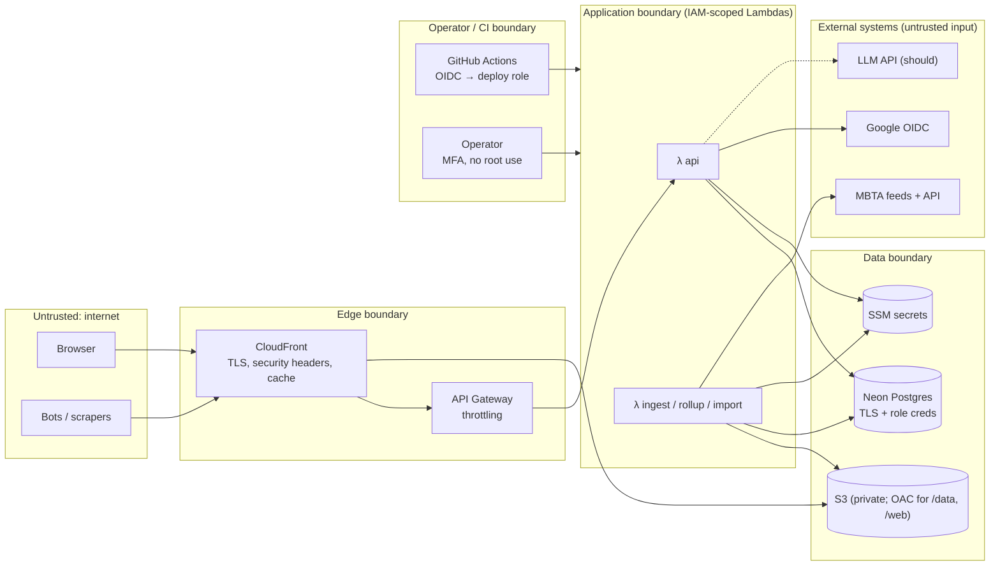

# 05 — Security, Privacy and Reliability

*Phase 3 (design) · 2026-10-18 · builds on [04-architecture.md](04-architecture.md)*

## 1. Threat model

**What we protect.**

| Asset | Why it matters |
|---|---|
| Saved commutes | They reveal where and when a person routinely travels (home and work patterns) |
| User identity | Email address and Google subject ID |
| Sessions and the CSRF token | Account takeover |
| AWS account and bill | A runaway cost is a real harm for a $0 project |
| Integrity of published metrics | People may cite them; wrong numbers erode trust |
| Secrets | Neon credentials, OAuth client secret, session-signing key, VAPID key |

**Who might attack, or simply fail.** Anonymous internet users, scrapers and bots, authenticated users trying to reach other users' data, **the agency feed itself (untrusted input)**, a compromised dependency, a compromised CI pipeline, and operator error.

### Trust boundaries

Every arrow that crosses a boundary has controls: validation, authentication, least-privilege IAM, size and time limits.

## 2. Authentication

- **Google OIDC**, authorization-code flow with **PKCE**, `state` and `nonce`. The ID token is verified for issuer, audience, expiry and nonce against Google's JWKS, which Authlib caches. Only the `openid email profile` scopes are requested.
- **Server-side sessions:**
  - A 256-bit random token in the cookie `__Host-sw_session` (HttpOnly; Secure; SameSite=Lax; Path=/).
  - Only its SHA-256 hash is stored in `sessions`, so a database leak doesn't leak live sessions.
  - Idle timeout 7 days; absolute limit 30 days (24 h for demo users).
  - The session is rotated on login, and logout deletes it server-side.
  - "Sign out everywhere" deletes all of a user's sessions.
- **CSRF:**
  - The app and API are **same-origin** (CloudFront routes `/api/*`), so no CORS is configured. Cross-origin calls are rejected by default.
  - SameSite=Lax blocks most cross-site POSTs.
  - A double-submit `X-CSRF-Token` header is required for every state-changing request as a second layer.
- **Demo accounts:** isolated users with `is_demo = true`, created by `POST /auth/demo`. Limits:
  - 3 per hour per IP prefix, and at most 500 active at once.
  - Limited features (3 commutes, no push alerts, no Ask).
  - Purged by the daily maintenance job.
- **No passwords, no account linking, no email sending** in the MVP. This removes whole classes of risk: credential stuffing, reset-token abuse and email deliverability.

## 3. Authorization

- **Deny by default.** Every route declares a policy: `public`, `session`, or `session+owner`.
- **Object-level checks live in the data layer, not only in handlers.** Repository functions take an `owner_id` and add `WHERE user_id = :owner_id`, so a missing check can't be "forgotten" in one handler. A row that doesn't match returns `404`, not `403`, so IDs of other users' objects aren't confirmed.
- **Authorization test matrix:** every endpoint × {anonymous, demo user, user A, user B} with expected status codes. It runs in CI. This is the main defense against OWASP API #1, Broken Object Level Authorization.
- **No in-app admin role.** Operator actions go through the AWS console or CLI (MFA) and runbooks. That removes an entire privileged surface from the web app.
- **IAM least privilege per function:**

| Function | Allowed |
|---|---|
| `ingest-tick` | `s3:GetObject/PutObject` on `state/*`, `events/*`, `raw/*`; read the agency config parameter; `lambda:InvokeFunction` on `notify` (should). **No database credentials.** |
| `daily-rollup` | Read `events/*`, `schedule/*`, `curated/*`; write `curated/*`, `public/*`; read the app DB parameter |
| `schedule-import` | Write `schedule/*`; read the owner DB parameter for the catalog upsert |
| `api` | Read app DB, OAuth, session-key and VAPID parameters. No S3 access at all. |
| `maintenance` | Read the owner DB parameter (purges expired sessions, demo users, rate-limit rows, and audit rows > 365 days); `s3:ListBucket` on the `backups/` prefix only (to verify last night's backup exists) |
| GitHub deploy role | Trusts only `repo:<owner>/<repo>:environment:prod` via OIDC; scoped to tagged project resources |

## 4. OWASP risk coverage

These are mapped by risk name from the OWASP Top 10 and the OWASP API Security Top 10 (2023).

| Risk | How Stopwatch is exposed | Control | Verified by |
|---|---|---|---|
| Broken (object-level) access control | `/commutes/{id}` IDs | Owner-scoped repositories; 404 on mismatch; UUIDv4 IDs | Authorization matrix tests; ZAP baseline on staging |
| Broken authentication | Login, sessions, demo | OIDC + PKCE; hashed session tokens; rotation; `__Host-` cookie | Unit tests for token validation (bad iss, aud, nonce, expiry); cookie-flag tests |
| Injection | SQL, the Ask feature | SQLAlchemy bound parameters only (raw string SQL banned by a lint rule); Ask never generates SQL (fixed tools, §6) | Semgrep rules; tests with injection payloads |
| Cryptographic failures | Cookies, secrets, transit | TLS everywhere (CloudFront TLSv1.2_2021 policy; Neon `sslmode=verify-full`); SSM SecureString; SHA-256 token hashing | Config tests; IaC scanner |
| Insecure design | Demo, alerts, cost | Abuse cases written down (this doc); quotas; concurrency caps; budget alarms | Threat-model review in PR template |
| Security misconfiguration | S3, CloudFront, headers | Block Public Access on all buckets; OAC-only bucket policies; TLS-only (`aws:SecureTransport`); strict response-headers policy | Checkov/Trivy on Terraform; header test in smoke suite |
| Vulnerable or outdated components / supply chain | PyPI, npm, Actions | Lockfiles with hashes (uv, npm); Dependabot; `pip-audit` + `npm audit` + OSV-Scanner; Actions pinned to commit SHAs | CI gates (high or critical → fail) |
| Software and data integrity failures | Deploy pipeline, published data | OIDC deploy (no static keys); protected `prod` environment with required approval; data-quality gate before the manifest swap | Branch protection; rollup gate tests |
| Logging and monitoring failures | Everything | Structured logs with request IDs; audit log; alarms (see [06](06-quality-operations.md)) | Alarm tests in staging (forced failures) |
| SSRF / unsafe consumption of APIs | Agency feeds | Feed URLs come from config, not user input; no redirects to other hosts; 5 MB body cap; 3 s/10 s timeouts; protobuf parse errors contained; value sanity checks (timestamps within ±1 day, sequence ranges) | Fuzz tests with malformed or oversized feeds |
| Unrestricted resource consumption | API, demo, Ask, cost | API Gateway throttles; per-user and per-IP counters; reserved concurrency; Ask quotas and a $ cap; budgets | Load test confirms throttling at limits |
| Mass assignment / excessive data exposure | Commute PATCH, `/me` | Explicit Pydantic input and output models; no ORM objects returned | Schema tests; OpenAPI diff |

**Security headers** (CloudFront response-headers policy):

- `Content-Security-Policy: default-src 'self'; connect-src 'self' https://api-v3.mbta.com; img-src 'self' data:; script-src 'self'; style-src 'self' 'unsafe-inline'; frame-ancestors 'none'; base-uri 'none'; form-action 'self'`
  - Inline *styles* are allowed because the charting library injects them. *Scripts* stay strict, and that is where the XSS risk is. Add the map-tile origin and `worker-src blob:` if the map view (could) ships.
- HSTS: 2 years, includeSubDomains
- `X-Content-Type-Options: nosniff`
- `Referrer-Policy: strict-origin-when-cross-origin`
- `Permissions-Policy: geolocation=(self), camera=(), microphone=()`

## 5. Privacy

| Data | Purpose | Sensitivity | Retention | Access |
|---|---|---|---|---|
| Email, Google subject, display name | Login, account identity | Personal | Until account deletion | The user; the operator (incident only) |
| Saved commutes | Personal summaries, alerts | **High** (location patterns) | Until deleted by the user or the account | The user only |
| Sessions (hash, IP /24 prefix, user agent) | Security | Personal | 30 days max; expired rows purged daily | System |
| Push endpoints *(should)* | Delivering alerts | Personal | Until unsubscribed, or a 410 Gone response | System |
| Audit log | Security forensics | Pseudonymous (user UUID, IP prefix) | 365 days | Operator |
| Precise location (near-me) | Nearest stops | High | **Never leaves the device** (computed client-side from the stop index) | — |
| Ask questions *(should)* | Answering | May contain personal context | Not stored beyond usage counters; never sent to the LLM with user IDs | — |

Principles:

- **Data minimization.** No analytics SDKs or third-party trackers. The only cookie is essential, so no cookie banner is needed.
- **Logs contain user IDs, never emails or commute details.** A log-scrubbing filter and a test enforce this.
- **User rights.** Export (`GET /me/export`) and deletion (`DELETE /me`, immediate cascade; backups age out within 30 days, as stated in the privacy policy).
- **Honesty.** The privacy page states what is collected in plain language, plus the "unofficial estimates" disclaimer.

## 6. The Ask feature (should): LLM-specific controls

- **Tool-calling over a fixed set of functions:** `find_stop(name)`, `stop_reliability(stop_id, route_id?, day_type?, hours?)`, `compare(route_a, route_b, stop_id?, day_type, hours)`. They execute server-side against **published JSON only**. There is no SQL generation, no code execution and no access to user data.
- **Prompt-injection posture:** the only untrusted text is the user's own question and public transit names. Tools are read-only and parameters are schema-validated, so a successful injection can at most produce a wrong *answer*, never an action.
- **Grounding check:** every number in the answer must appear in the tool results (±rounding). Otherwise the UI shows the structured tool result instead of prose.
- **Evals:** a labeled set of 60 questions (expected tool + parameters + key numbers), run on demand and nightly in staging with a cost cap. Metrics: tool-selection accuracy, parameter accuracy, grounding pass rate, refusal correctness for out-of-scope questions.
- **Cost controls:**
  - Signed-in, non-demo users only, 20 questions a day each.
  - Responses cached by normalized question + `build_id`.
  - A global monthly cap of **$1** tracked in `ask_usage`. At the cap, the feature switches to a guided form with no LLM.
  - The smallest model tier that passes the evals.

## 7. Rate limiting and abuse

| Layer | Mechanism | Default |
|---|---|---|
| CDN | Static data and SPA served from cache. Origin requests for `/data/*` are rare | — |
| API Gateway | Stage throttle; tighter route throttles on `/auth/*` | 20 rps steady / 40 burst; auth routes 5 rps |
| Application | Fixed-window counters in `rate_limit_counters` (atomic `INSERT … ON CONFLICT DO UPDATE … RETURNING count`), keyed by user or IP prefix | See the API table in [04 §8.2](04-architecture.md) |
| Compute | Reserved concurrency: api 10, ingest 1, jobs 1 each | Caps the worst-case bill |
| Spend | AWS Budgets $1 actual / $5 forecast; Ask $ cap | Email the operator |

## 8. Secrets management

- **Storage:**
  - Runtime secrets in SSM Parameter Store SecureString under `/stopwatch/{env}/…`.
  - Loaded at cold start through Powertools Parameters with a 5-minute cache.
  - Non-secret config in environment variables.
  - **No secrets in Terraform state.** Parameters are created with placeholder values and set out-of-band via the CLI.
- **Local:** `.env` (gitignored) generated from `.env.example`. Local Postgres uses throwaway credentials.
- **CI:** no AWS keys exist. GitHub OIDC assumes `stopwatch-deploy-{env}`. Gitleaks runs as a pre-commit hook and in CI.
- **Rotation runbooks** for the Neon password, the OAuth client secret, the session pepper/CSRF key and the VAPID key. Rotating the session key invalidates sessions, by design.
- **Account hygiene:** root account with MFA and unused; operator IAM Identity Center user with MFA; CloudTrail event history (90 days, free) used for investigations.

## 9. Audit logging

- **Recorded actions:**
  - `auth.login`, `auth.login_failed`, `auth.logout`, `auth.logout_all`, `auth.demo_created`
  - `commute.create`, `commute.update`, `commute.delete`
  - `account.export`, `account.delete`
  - `alert.configure`, `push.subscribe`, `push.unsubscribe`
  - `ask.cap_reached`, `ratelimit.blocked` (sampled)
  - `system.demo_purge`, `system.publish`, `system.publish_rollback`
- **Each record has** actor kind and ID, action, target, outcome, request ID, IP prefix, and non-PII details.
- **Append-only:** the runtime role has no `UPDATE`/`DELETE` grant on `audit_log`. Old rows are purged after 365 days by the owner role's maintenance function.
- **Uses:** incident investigation, the user-facing "recent security activity" list (could), and abuse detection (e.g., demo-creation spikes).

## 10. Reliability

### 10.1 SLOs and error budgets

| SLO | Target (rolling 30 days) | Budget | Measured by |
|---|---|---|---|
| Ingestion freshness | 99% of minutes have a successful tick | 432 min/month | `IngestSuccess` count vs expected minutes |
| Daily publication | Published by 06:00 ET on 29 of 30 days | 1 late day | `RollupSuccess` + manifest timestamp |
| API availability | 99.5% of requests non-5xx | ~3.6 h/month | API Gateway 5xx / count |
| API latency | p95 < 300 ms (warm); p99 < 3 s (cold path) | — | API Gateway latency percentiles |
| Alert delivery *(should)* | 95% within 2 min of trigger | — | `notifications.sent_at − created_at` |

**Error-budget policy:** if the freshness budget is exhausted, feature work pauses and the next work item is a reliability fix plus a postmortem.

### 10.2 Failure handling

| Failure | Detection | Behavior | Recovery |
|---|---|---|---|
| MBTA feed down or slow | Fetch timeout or 5xx; `FeedAgeSeconds` | Retry ≤ 2 within the tick; then skip; site banner if > 15 min | Automatic on the next tick; gap recorded in health.json |
| Feed timestamp not advancing | `header.timestamp ≤ prev` | No-op tick (no false "disappearances") | Automatic |
| Malformed or oversized feed | Parse error / size cap | Tick fails; raw payload saved to `raw/errors/` | Runbook RB-2: inspect sample, patch parser |
| Overlapping ticks | Reserved concurrency 1 + `If-Match` CAS | A second writer fails rather than corrupting state | Automatic |
| Lost state object | 404 on read | Cold start: index the current snapshot, emit nothing this tick | Automatic; that minute is low-confidence |
| Rollup bad data | Quality gate | Don't swap the manifest; previous build stays live | RB-3 |
| Bad publish slips through | User report / anomaly | — | Manifest rollback (one command) |
| Neon cold or unavailable | Connection error/timeout | Retry with backoff (100 ms → 1.6 s, 4 tries) on connect only; public pages unaffected (static) | Neon status; RB-4 |
| Lambda cold start | Latency p99 | Lean API package (no DuckDB), lazy imports | Accept; documented tradeoff |
| Schedule change mid-day | New feed version | Each service_date joins against the version valid for that date | Automatic |
| Daylight-saving transitions | — | Service-day time math in `core.gtfs` (tested on DST dates) | — |
| Push endpoint gone *(should)* | HTTP 404/410 | Delete the subscription | Automatic |
| Runaway cost | Budget alarm; throttles | Concurrency caps limit the blast radius | RB-5 |

### 10.3 Retries and idempotency rules

- Retry only **idempotent** operations, with exponential backoff and full jitter, always within the caller's deadline. A tick never retries past its own minute.
- Writes use **deterministic keys**: events by minute, curated data by partition, publishes by `build_id`, notifications by `dedupe_key`, API creates by `Idempotency-Key`.
- **At-least-once everywhere, deduplicated downstream.** Exactly-once is not claimed anywhere.

### 10.4 Caching

| Cache | What | TTL / invalidation |
|---|---|---|
| CloudFront | SPA assets (content-hashed) | 1 year, immutable |
| CloudFront | `index.html` | no-cache (revalidate) |
| CloudFront | `/data/v1/{build}/…` | 1 year (immutable by build) |
| CloudFront | `manifest.json`, `health.json` | 60 s |
| Browser | TanStack Query | stale-while-revalidate, 5 min |
| Lambda memory | Catalog lookups, SSM parameters, JWKS | warm-container lifetime / 5 min |

There is **no Redis**, because reads are already served from the CDN and the dynamic API is per-user and low-volume. A shared cache would add cost without a measured need.

### 10.5 Backups and disaster recovery

| Data | Protection | RPO | RTO |
|---|---|---|---|
| Postgres | Neon point-in-time restore (free-plan window is short; check current limits) + **nightly `pg_dump`** from GitHub Actions to a versioned S3 prefix (30-day lifecycle) | ≤ 24 h (≤ hours via PITR) | < 1 h |
| Curated Parquet, published builds | S3 versioning on `curated/` and `public/`; 14 builds retained | 0 for committed data | Minutes (manifest swap / version restore) |
| Real-time observations | **Irreplaceable** (the feed is ephemeral). Protected by the ingest SLO; gaps are visible, never back-filled with guesses. Subway gaps can be optionally back-filled from LAMP | 1 min per missed tick | — |
| Infrastructure | Terraform in git; state in a versioned bucket | — | < 1 h (`make up`) |
| Secrets | SSM; documented re-creation steps | — | < 30 min |

**Restore drill:** quarterly, restore the latest dump into a Neon branch, run the integration suite against it, and record the timing in `docs/runbooks/restore-drill.md`.

## 11. Performance goals (measurable)

| Goal | Target | How it is measured |
|---|---|---|
| Public page TTFB (cached) | p95 < 200 ms | k6 against CloudFront; CloudWatch CloudFront metrics |
| Mobile LCP (route page, mid-tier phone, 4G) | < 2.5 s | Lighthouse CI on every PR (budget file) |
| Initial JS bundle | < 200 KB gzip | Vite build-size check in CI |
| Stop search | < 100 ms per keystroke for 8k stops | Vitest benchmark |
| API p95 (warm) | < 300 ms | API Gateway percentiles; k6 at 20 rps |
| API cold path | p99 < 3 s (Lambda + Neon wake) | Synthetic test after 10 min idle |
| Ingest tick duration | p95 < 15 s, p99 < 40 s (timeout 50 s) | `IngestDurationMs` |
| Feed-to-event lag | p95 < 2 min | `observed_at − est_arrival` distribution |
| Daily rollup | < 5 min for one day of MBTA data | Job duration metric |
| Inference accuracy | median abs. error ≤ 45 s, p90 ≤ 120 s vs LAMP | Weekly validation report |
| Cost | ≤ $1/month steady state | AWS Budgets + monthly cost review |
