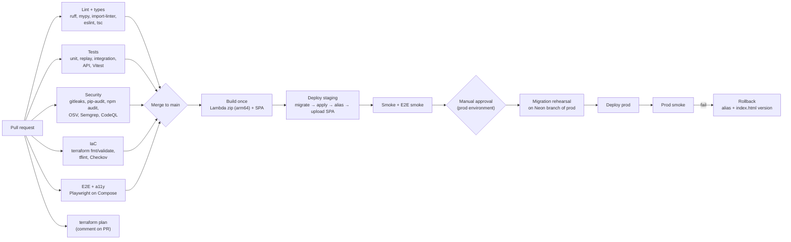

# 06 — Testing, Delivery and Operations

*Phase 3 (design) · 2026-10-18 · builds on [04](04-architecture.md) and [05](05-security-reliability.md)*

## 1. Testing strategy

The riskiest code is the pure core (inference, GTFS time math, metrics), so it gets the deepest testing. Glue code gets integration tests, and the UI gets a thin layer of end-to-end tests.

| Layer | Scope | Tools | Runs | Gate |
|---|---|---|---|---|
| Unit | `core.*` (inference, gtfs time, metrics), authorization policies, validators | pytest, **Hypothesis** (property-based) | Every push | Fails CI; ≥ 90% line + branch coverage on `core` |
| Replay ("golden") | Recorded MBTA snapshot sequences → expected arrival events | pytest + checked-in fixtures (trimmed to ~5 routes, ~10 consecutive minutes) | Every push | Exact match; updating goldens requires a reviewed diff |
| Integration | Repositories, migrations, rate limiter, sessions; S3 adapter; DuckDB rollup SQL on fixture Parquet | pytest + Postgres 17 service container; moto for S3 | Every push | Fails CI |
| API | Every route: schemas, status codes, **authorization matrix** (anon / demo / user A / user B), CSRF, idempotency replay | FastAPI TestClient, Schemathesis (fuzz from OpenAPI) | Every push | Fails CI |
| Contract (internal) | OpenAPI spec diff against `main` | oasdiff | PR | Breaking change needs the `api-breaking` label |
| Contract (external) | **Feed-drift check:** live MBTA snapshot vs our assumptions (fields present, past stops dropped, SKIPPED share, timestamps fresh) | Scheduled workflow | Nightly | Opens a GitHub issue |
| Frontend unit | Components, hooks, stop-search ranking, client-side commute summary math | Vitest + React Testing Library | Every push | Fails CI |
| End-to-end | Search → stop page → heatmap; demo login → save commute → summary; delete account; "near me" makes no location network request | Playwright against Docker Compose in replay mode | Every PR | Fails CI |
| Accessibility | Key pages | axe-core via Playwright | Every PR | No serious or critical violations |
| Performance | Bundle size, Lighthouse budgets; k6 against staging (20 rps API, 200 rps CDN) | Vite size check, Lighthouse CI, k6 | PR / weekly | Budget files |
| Data quality | Each rollup: coverage, row-count deltas, null rates, delay sanity (−30…+120 min) | Checks inside `daily-rollup` | Every run | Blocks the manifest swap |
| Inference accuracy *(should)* | Estimates vs MBTA LAMP subway arrivals | `lamp-validate` job | Weekly | Report; regression > 20% opens an issue |
| Ask evals *(should)* | 60 labeled questions | Eval harness (staging, cost-capped) | Nightly / on label | Tool accuracy ≥ 90%, grounding 100% |
| Security | See §6 | — | — | — |

**Test data:**

- A **hand-built mini GTFS feed**: 2 routes, 8 stops, a trip crossing midnight (`25:10:00`), and service on a daylight-saving transition date.
- Snapshot **builders** that create `FeedMessage` objects in code, for property tests.
- **Recorded live snapshots** for replay tests.

No production user data is ever used in tests.

**Example property tests for inference:**

- Shuffling ticks inside a run never creates duplicate (trip, stop_sequence) arrivals.
- `est_arrival ≤ observed_at` always holds.
- Replaying the same sequence twice gives identical output.
- Removing one tick produces only `low`-confidence events for the affected stops.

## 2. CI/CD (GitHub Actions)



**Workflows:**

- `ci.yml`: every PR and push.
- `codeql.yml`: GitHub's default setup.
- `deploy.yml`: on merge to `main`. Staging automatically, prod behind approval.
- `nightly.yml`: `pg_dump` backup, feed-drift check, Ask evals, Lighthouse.
- `weekly.yml`: k6, OWASP ZAP baseline against staging, LAMP validation.
- `teardown.yml`: manual dispatch; destroys staging.

**Rules:**

- Actions are pinned to commit SHAs. Workflow `permissions:` default to read-only. Only deploy jobs get `id-token: write`.
- Artifacts are **built once and promoted**. Staging and prod run the same zip, verified by SHA-256.
- Packaging builds arm64 wheels on x86 runners with `uv pip install --python-platform aarch64-manylinux2014 --only-binary=:all:`. No QEMU or Docker emulation is needed.
- Branch protection on `main`: required checks, linear history, no force-push.
- Conventional commits feed an automatic `CHANGELOG.md` on release tags.

## 3. Docker (local development)

`compose.yaml`:

| Service | Image | Purpose |
|---|---|---|
| `db` | `postgres:17-alpine` | Local Postgres with throwaway credentials; healthcheck |
| `api` | `backend/Dockerfile.dev` (Python 3.13, uv) | `uvicorn stopwatch.api.main:app --reload` |
| `worker` | same image | `python -m stopwatch.jobs.local_scheduler --mode live` (or `--mode replay fixtures/…`): runs ingest every 60 s and rollup on demand, using the **file-system blob store** in `./.localdata` |
| `web` | `node:22-alpine` | `vite` dev server, proxying `/api` and `/data` |

- `make dev` starts everything. `make seed` imports the static GTFS and loads a demo user.
- **Production does not run containers.** Lambda zip packages are cheaper and simpler here. The dev image pins the same Python minor version as Lambda for parity.

## 4. Infrastructure as code (Terraform)

```text
infra/
  bootstrap/            # one-time: state bucket (versioned, encrypted) — never destroyed by make down
  modules/
    storage/            # data + web buckets, lifecycle rules, versioning, Block Public Access, TLS-only policies
    functions/          # one module instance per entry point: role, log group (14 d), alias, reserved concurrency
    scheduler/          # EventBridge Scheduler schedules (ET time zone), retry policies, DLQ
    api/                # HTTP API, routes, throttling, stage logs
    edge/               # CloudFront, OAC, response-headers policy (CSP/HSTS), behaviors /api /data /
    observability/      # SNS topic, 10 alarms, 3 dashboards
    budget/             # $1 actual / $5 forecast budgets
    github_oidc/        # OIDC provider + deploy roles scoped to repo/environment
  envs/
    staging/  main.tf  terraform.tfvars   # ingest schedule disabled by default
    prod/     main.tf  terraform.tfvars
```

- **One command each way:** `make up ENV=staging` / `make down ENV=staging`.
- **Data safety:** buckets holding curated data have `force_destroy = false` in prod. `make down ENV=prod` refuses to run unless `ALLOW_DATA_DESTROY=1` is set, which makes the "delete everything" path deliberate.
- **Tagging:** everything is tagged `project=stopwatch env=<env> owner=<you> ttl=<date|none>`. A tag-based Cost Explorer view shows spend per environment.
- **Scanning:** Checkov (or Trivy config) on every PR. Accepted exceptions are recorded inline with a justification, for example "no VPC for Lambda" (ADR-010).

## 5. Database migrations

- **Alembic**, with one migration per PR when the schema changes.
- **Expand → migrate → contract:** add nullable columns or tables first, deploy code that writes both shapes, backfill with a job, then remove the old shape in a later release. Every release stays compatible with the schema before and after it, so a rollback is safe.
- Every migration has a tested `downgrade`. CI runs `upgrade head → downgrade base → upgrade head` on an empty database **and** on a fixture-populated one.
- Migrations set `lock_timeout = '3s'` and `statement_timeout = '60s'`. Long backfills belong in jobs, not migrations.
- **Prod rehearsal:** the deploy job creates a short-lived Neon **branch** of prod (copy-on-write), runs the migration and the integration smoke there, deletes the branch, and only then migrates prod. Check that free-plan branch limits allow this; if not, rehearse against a restored dump in staging.
- Migrations run with the `stopwatch_owner` role. The app never has DDL rights.

## 6. Environment and configuration management

| Setting | local | staging | prod | Source |
|---|---|---|---|---|
| `DATABASE_URL` | Compose Postgres | Neon `staging` branch | Neon `main` | SSM (cloud) / `.env` (local) |
| `BLOBSTORE` | `file://./.localdata` | `s3://stopwatch-staging-data` | `s3://stopwatch-prod-data` | env var |
| `INGEST_ENABLED` | true (worker) | false (toggle for tests) | true | Terraform variable → schedule state |
| `ALERTS_ENABLED`, `ASK_ENABLED` | true | true | per rollout | env var (feature flag) |
| `DEMO_ENABLED` | true | true | true | env var |
| `ASK_MONTHLY_CAP_USD` | 0 (stubbed LLM) | 0.25 | 1.00 | SSM |
| OAuth client | Google "localhost" client | staging client | prod client | SSM |

- Config is parsed once by **pydantic-settings** and the process fails fast on missing or invalid values.
- `.env.example` documents every key. `.env` is gitignored, and gitleaks blocks committing secrets.

## 7. Security scanning

| Tool | Finds | When | Blocking |
|---|---|---|---|
| gitleaks | Committed secrets | pre-commit + CI | Yes |
| pip-audit, `npm audit`, OSV-Scanner | Known-vulnerable dependencies | CI + nightly | High or critical: yes |
| Dependabot | Outdated dependencies, Actions | Weekly PRs | — |
| CodeQL | Code-level vulnerabilities (Python, JS/TS) | PR + weekly | High: yes |
| Semgrep (curated + custom rules) | Raw SQL strings, `verify=False`, logging of PII fields, missing owner scope in repositories | CI | Yes |
| Checkov / Trivy config | Terraform misconfigurations | CI | Yes (with justified exceptions) |
| OWASP ZAP baseline | Headers, cookies, common web issues on staging | Weekly | Report → issue |
| Authorization matrix tests | IDOR / BOLA | CI | Yes |

## 8. Monitoring

**Logs.**

- Powertools Logger writes JSON lines with `request_id` / `tick_id`, `env`, `version`, `function` and `duration_ms`.
- A scrubbing filter drops keys such as `email`, `label` and `token`. A unit test proves it.
- The ingest tick writes **one** summary line per run, which keeps logs well under CloudWatch's 5 GB/month free tier.
- Retention is 14 days.

**Custom metrics** (CloudWatch EMF, namespace `Stopwatch`, dimension `env` only). This is ≤ 10 metrics, matching the free tier:

| # | Metric | Unit |
|---|---|---|
| 1 | `IngestSuccess` | count per tick |
| 2 | `IngestDurationMs` | ms |
| 3 | `FeedAgeSeconds` | s (now − feed header timestamp) |
| 4 | `ArrivalsEmitted` | count |
| 5 | `LowConfidenceRatio` | % |
| 6 | `RollupSuccess` | count |
| 7 | `RollupCoveragePct` | % |
| 8 | `AuthFailures` | count |
| 9 | `NotificationsSent` *(should)* | count |
| 10 | `AskCostMicroUSD` *(should)* | µ$ |

Lambda (errors, throttles, duration), API Gateway (count, 4xx, 5xx, latency) and CloudFront metrics are built in and free.

**Tracing:** X-Ray via Powertools Tracer on the API and jobs, with sampling inside the 100k traces/month free tier.

**Dashboards** (3, the free-tier limit):

- **Pipeline:** freshness, tick duration, arrivals/min, low-confidence %, coverage.
- **API:** requests, errors, latency percentiles, throttles, auth failures.
- **Cost & abuse:** invocations per function, demo creations, Ask spend, rate-limit blocks.

**Public status:** `health.json` and the data-health page show riders the same freshness and coverage the operator sees.

## 9. Alerts

There are 10 CloudWatch alarms (the free-tier limit) plus 2 AWS Budgets. All route to the SNS topic `stopwatch-alerts` → operator email. Each alarm description contains its severity and runbook link.

| Alarm | Condition | Severity | Runbook |
|---|---|---|---|
| `IngestStale` | `IngestSuccess` < 1 for 5 consecutive 1-min periods (missing data = breaching) | SEV-2 | RB-1 |
| `IngestErrorRate` | ingest Lambda errors / invocations > 20% over 15 min | SEV-3 | RB-1 / RB-2 |
| `FeedStale` | `FeedAgeSeconds` max > 300 for 10 min (upstream problem) | SEV-3 | RB-1 |
| `RollupLate` | `RollupSuccess` < 1 in the day window ending 06:00 ET | SEV-3 | RB-3 |
| `RollupLowCoverage` | `RollupCoveragePct` < 80 | SEV-3 | RB-3 |
| `Api5xx` | 5xx > 5% of ≥ 20 requests over 5 min | SEV-2 | RB-4 |
| `ApiLatencyP95` | p95 > 1 s for 15 min | SEV-3 | RB-4 |
| `ApiThrottles` | API function throttles > 0 for 5 min | SEV-3 | RB-5 |
| `AuthFailureSpike` | `AuthFailures` > 50 in 10 min | SEV-3 | RB-6 |
| `NotifyDLQ` *(should)* | DLQ visible messages > 0 | SEV-3 | RB-1 |
| Budget: actual > $1 | AWS Budgets | SEV-3 | RB-5 |
| Budget: forecast > $5 | AWS Budgets | SEV-2 | RB-5 |

**Severity meaning:**

- **SEV-2:** user-visible outage or data loss in progress. Respond the same day.
- **SEV-3:** degradation. Respond within 48 h.
- Every SEV-2 gets a postmortem.

## 10. Incident runbooks

Runbooks live in `docs/runbooks/`. Each follows the same template: **symptoms → impact → diagnose → mitigate → verify → follow up**.

### RB-1: Ingestion stale

- **Symptoms:** `IngestStale` alarm; site banner "data delayed".
- **Impact:** a gap in observations, which can't be recovered for bus and costs ~1 minute of data per minute down.
- **Diagnose:**
  1. Is the scheduler invoking? Check `ingest-tick` invocations in the Pipeline dashboard.
  2. Read the last errors with Logs Insights:
     ```text
     fields @timestamp, level, message, error_type, http_status
     | filter function = "ingest-tick" and level = "ERROR"
     | sort @timestamp desc | limit 20
     ```
  3. Is it upstream? Check `FeedAgeSeconds` and run `curl -I https://cdn.mbta.com/realtime/TripUpdates.pb`.
  4. Is it throttled or timing out? Check the Lambda `Throttles` and `Duration` metrics against the 50 s timeout.
- **Mitigate:**
  - Upstream outage → nothing to fix; confirm the banner shows and record the gap.
  - Our bug → roll back the alias: `make rollback FN=ingest-tick`.
  - State corruption → delete `state/mbta/latest.json.gz`. The next tick cold-starts safely.
- **Verify:** `IngestSuccess` resumes; `health.json` updates within 2 minutes.
- **Follow up:** postmortem if it ran over 30 min; update the error-budget tracking.

### RB-2: Feed parse errors / schema drift

- **Symptoms:** `IngestErrorRate` alarm with `error_type=ParseError`, or the nightly drift-check issue.
- **Diagnose:**
  1. Download the failing payload from `raw/errors/…`.
  2. Run `make replay FILE=…` locally.
  3. Compare against the MBTA GTFS-RT docs and changelog.
- **Mitigate:**
  1. Patch the parser behind a test that uses the captured payload.
  2. Deploy.
  3. If the new behavior is ambiguous, ship a guard that skips the unknown entities and logs them, rather than failing the whole tick.
- **Follow up:** add the payload to the replay fixtures.

### RB-3: Rollup failed or bad data published

- **Symptoms:** `RollupLate` or `RollupLowCoverage`; a user reports implausible numbers.
- **Diagnose:** the rollup's data-quality report in `public/_reports/{date}.json` (coverage, row deltas, null rates); ingest gaps for that service day.
- **Mitigate:**
  - The gate failed → the previous build is already live. Fix and re-run: `make rollup DATE=…`.
  - Bad data slipped through → `make publish-rollback BUILD=<previous>` (manifest swap, effective within 60 s).
- **Verify:** `manifest.json` points at the intended build; spot-check three routes against raw events.

### RB-4: API errors or latency

- **Diagnose:** `Api5xx` by route; Neon status page and connection errors in the logs (`error_type=OperationalError`); cold-start ratio (`Init Duration` in REPORT lines).
- **Mitigate:**
  - Neon incident → public pages keep working (static). Post a status note; the app degrades to read-only.
  - Bad deploy → `make rollback FN=api`.
  - Connection storms → lower API reserved concurrency and switch to the Neon pooled endpoint.

### RB-5: Cost spike or abuse

- **Diagnose:** Cost Explorer filtered by tag `project=stopwatch` (by service); dashboard invocations; demo-creation and rate-limit counters; top IP prefixes in the audit log.
- **Mitigate (fastest first):**
  1. Set `DEMO_ENABLED` / `ASK_ENABLED` to false.
  2. Lower reserved concurrency.
  3. Tighten API Gateway throttles.
  4. As a last resort, disable the API stage. Public static pages stay up.
- **Follow up:** adjust quotas; document the incident.

### RB-6: Suspected secret leak or account compromise

1. Rotate the affected secret in SSM.
2. Force a cold start: publish a new version and move the alias.
3. If the session key leaked: rotate it, which invalidates all sessions.
4. If a Neon password leaked: reset the role password and update SSM.
5. Review the audit log and CloudTrail for the exposure window.
6. If personal data was likely accessed: notify affected users, per the privacy policy commitment.

### RB-7: Restore the database

1. Choose a point: Neon PITR if within the window, otherwise the newest `pg_dump` in S3.
2. Restore into a **new branch** and run `make verify-db` (integration smoke).
3. Switch the `DATABASE_URL` parameter to the restored branch and redeploy the alias.
4. Record the RPO and RTO actually achieved in the drill log.

**Postmortem template** (blameless): summary, impact (users, data, duration), timeline, root cause (5 whys), what went well, what didn't, action items with owners and dates. Postmortems live in `docs/postmortems/` and are linked from the public changelog when users were affected.

## 11. Operating cadence

| Cadence | Activity |
|---|---|
| Weekly | Review the SLO dashboard and error budget; triage Dependabot PRs; read k6/ZAP reports |
| Monthly | Cost review (target ≤ $1); prune feature flags; check the feed-drift issue history |
| Quarterly | Restore drill (RB-7); rotate long-lived secrets; re-verify free-tier terms; review this threat model |
| Per release | Changelog, migration rehearsal, smoke, demo account sanity check |
